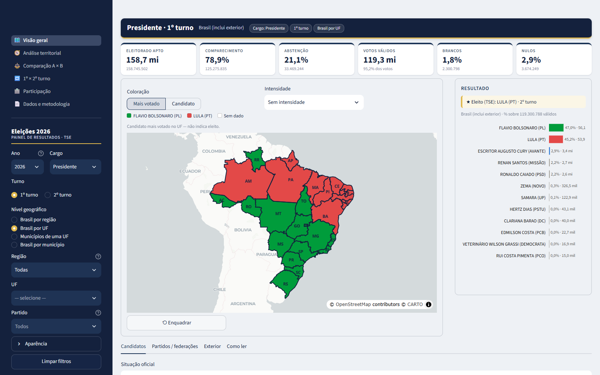
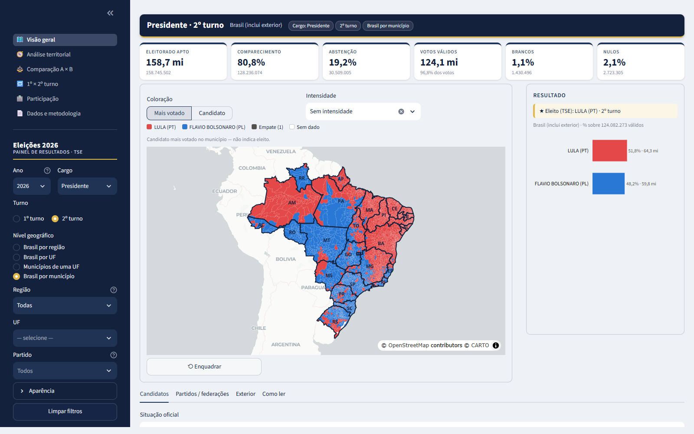
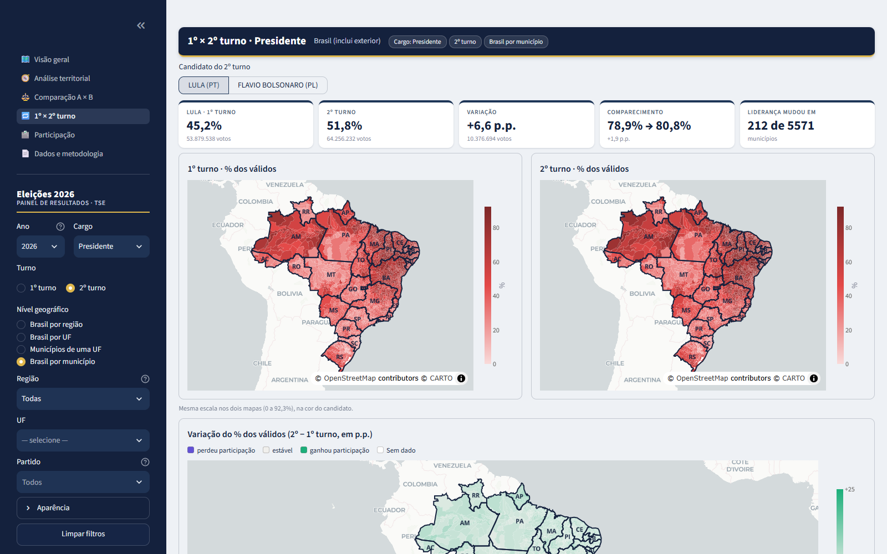
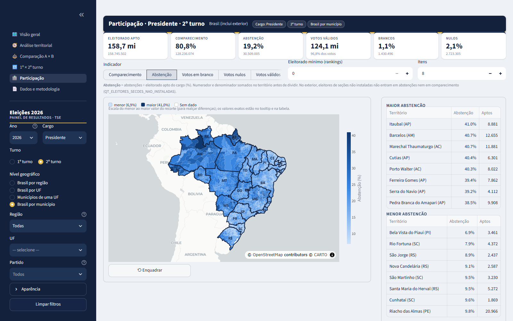
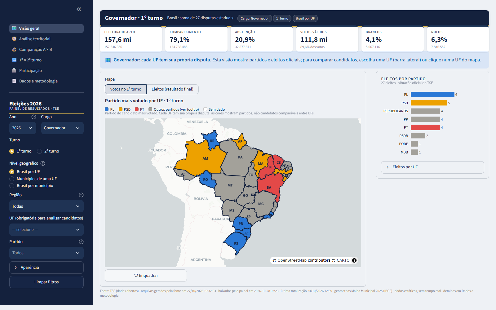
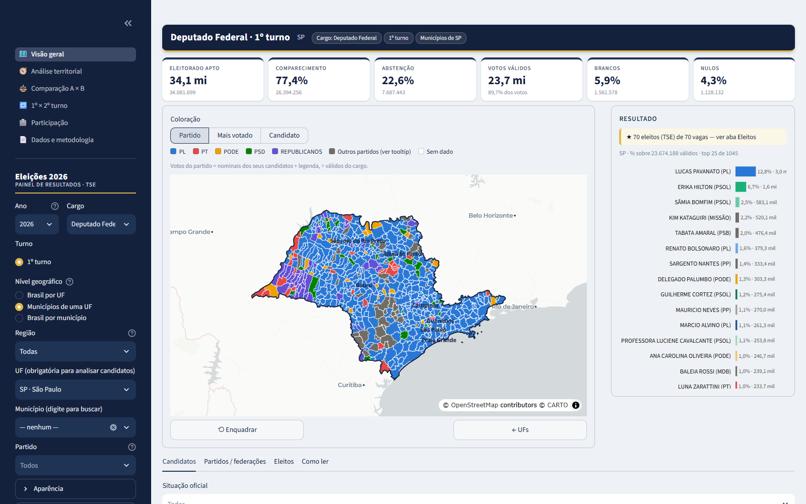
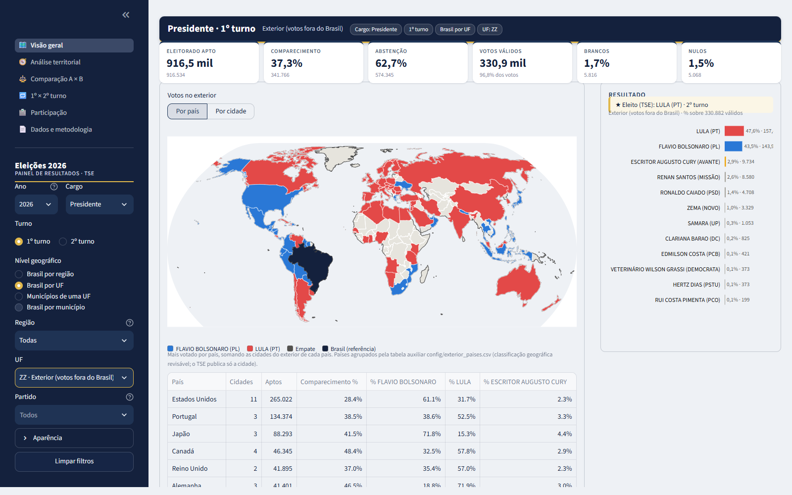
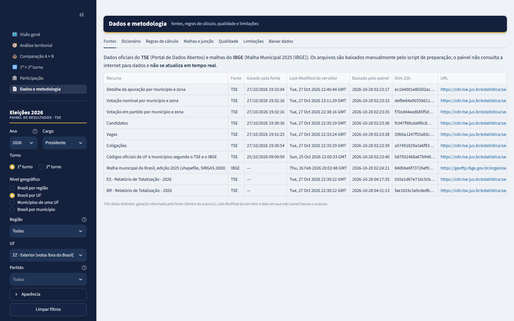

# Dashboard Eleições 2026

Dashboard interativo das eleições gerais brasileiras de 2026, com dados
oficiais do TSE e malhas territoriais oficiais do IBGE.

> **Estado atual: Etapas 1 a 7 concluídas**: todos os cargos, quatro níveis de
> mapa, análise territorial, comparação A × B, 1º × 2º turno, participação,
> votos no exterior (por país e cidade), exportação CSV e metodologia.
> Ver [Funcionalidades](#funcionalidades).

**Stack:** Python 3.11 · Streamlit · Plotly · DuckDB · Parquet · GeoPandas/Shapely



## Telas

| | |
|---|---|
|  |  |
| **Brasil por município (5.571)**: mais votado no 2º turno de presidente | **1º × 2º turno**: mapas na mesma escala, variação em p.p. e KPIs |
|  |  |
| **Participação**: indicador no mapa, com fórmula, denominador e rankings | **Governador**: 27 disputas estaduais, partido mais votado e eleitos oficiais |
|  |  |
| **Deputado federal (SP)**: votos por partido nos 645 municípios | **Exterior**: mais votado por país, com tabela por país e por cidade |
|  | |
| **Dados e metodologia**: fontes, dicionário, regras, qualidade e downloads | |

Prints gerados por `python -m scripts.capturar_telas` (dados oficiais reais; requer os dados
preparados e o Microsoft Edge ou o Google Chrome instalado).

## Executar o dashboard

**Jeito mais fácil (Windows):** dê dois cliques em **`Abrir Dashboard.bat`**, na pasta do
projeto. Na primeira vez, ele cria o ambiente Python, instala as dependências e (com a sua
confirmação) baixa e prepara os dados oficiais (~690 MB, 10–20 min). Depois disso, abre
direto no navegador. Para encerrar, feche a janela preta. Dica: clique com o botão direito
no arquivo → *Enviar para* → *Área de trabalho (criar atalho)*.

Pelo terminal (venv ativo):

```powershell
streamlit run app.py
```

Abre em http://localhost:8501. Requer os dados preparados (seção abaixo). As
malhas são servidas como arquivos estáticos (`static/geo/`, gerado pelo comando
`geografia`), por isso o app deve ser iniciado a partir da raiz do projeto.

## Requisitos

- Windows 10/11 com PowerShell
- Python 3.11 (testado com 3.11.5). O Python 3.14 também está instalado nesta
  máquina, mas não foi usado, para reduzir o risco com as dependências
  geoespaciais.
- Cerca de 6 GB livres para os dados brutos, os extraídos e a camada Parquet

## Instalação

```powershell
cd D:\Projetos\dashboard-eleicoes-2026
py -3.11 -m venv .venv
.\.venv\Scripts\Activate.ps1
python -m pip install --upgrade pip
python -m pip install -r requirements.txt
```

`requirements.txt` fixa as dependências diretas; `requirements-lock.txt` traz
o ambiente completo testado (`pip install -r requirements-lock.txt` para
reproduzir exatamente).

## Preparação dos dados

Nada é baixado automaticamente pela interface. A atualização é manual:

```powershell
python -m scripts.preparar_dados baixar      # TSE + malha IBGE 2025 (≈ 690 MB)
python -m scripts.preparar_dados auditar     # Parquet "bruto" + relatórios de layout e consistência
python -m scripts.preparar_dados geografia   # malhas simplificadas + junção TSE–IBGE
python -m scripts.preparar_dados modelar     # modelo tipado, disponibilidade, agregados, qualidade (~25 s)
python -m scripts.preparar_dados validar ES BR   # confronto com relatórios oficiais (PDF) de UFs e/ou BR
python -m scripts.preparar_dados listar      # o que foi baixado e quando
```

Rode na ordem acima. Cada etapa reaproveita o que já existe e falha com uma
mensagem dizendo o comando que falta, se um insumo não foi gerado.

- Downloads têm timeout, 4 tentativas com espera crescente, barra de progresso
  e conferência de tamanho. Arquivos ficam em `data/raw/` e não são alterados.
- Se o servidor informar o mesmo tamanho e a mesma `Last-Modified` registrados
  no manifesto, o arquivo local é reutilizado. Para forçar: `baixar --forcar`.
  Para um recurso só: `baixar --so detalhe_munzona`.
- `data/manifesto.json` registra URL, data do download, `Last-Modified` do
  servidor, data de geração informada pela fonte e SHA-256.

### Portal indisponível: importação local

Baixe o arquivo oficial por outro meio, sem renomear, e importe:

```powershell
python -m scripts.preparar_dados importar consulta_cand C:\Downloads\consulta_cand_2026.zip
```

## Testes

```powershell
python -m pytest                    # unitários (dados sintéticos, identificados nos arquivos)
python -m pytest -m integracao      # validação com os dados oficiais preparados
```

Desempenho (servidor, dados reais, sem cache):

```powershell
python -m scripts.medir_desempenho
```

## Estrutura

```
app.py                      ponto de entrada Streamlit (navegação entre páginas)
paginas/                    visão geral, análise territorial, comparação A × B, 1º × 2º turno,
                            participação, dados e metodologia
config/exterior_paises.csv  cidade do exterior → país (classificação auxiliar revisável)
config/cores_partidos.toml  cores fixas por partido escolhidas pelo usuário
.streamlit/config.toml      tema (identidade visual) e servidor de estáticos
static/geo/                 malhas publicadas para o navegador (geradas)
scripts/preparar_dados.py   CLI de atualização manual
scripts/medir_desempenho.py medição de custo das telas
src/config.py               caminhos e parâmetros (sem dados eleitorais fixos)
src/aquisicao/              catálogo de fontes, download, manifesto, extração segura
src/tratamento/             leitura dos CSV do TSE, camada Parquet bruta, chaves canônicas
src/modelagem/              modelo dimensional, vocabulário oficial, disponibilidade, agregados
src/metricas/               percentuais, margem, participação no par, liderança, indicadores
src/validacao/              auditoria, identidades contábeis, qualidade, confronto com PDF oficial
src/geografia/              malhas IBGE, simplificação topológica, junção TSE–IBGE
src/consultas/              consultas DuckDB usadas pela interface
src/visualizacoes/          cores, mapas, gráficos, modos de coloração, formatos pt-BR
src/componentes/            filtros dependentes, estado, mapa interativo, blocos visuais
prototipos/                 prova técnica do mapa da Etapa 1 (histórico)
tests/unit/                 testes com dados sintéticos
tests/integracao/           validação com dados oficiais
docs/                       metodologia, auditoria, geografia, relatórios gerados
data/                       raw/ processed/ geo/ (fora do controle de versão)
```

## Documentação

- [docs/auditoria_fontes.md](docs/auditoria_fontes.md): matriz de fontes, datas, layout e achados
- [docs/geografia.md](docs/geografia.md): edição da malha, simplificação, junção e prova de mapas
- [docs/modelo_dados.md](docs/modelo_dados.md): tabelas, granularidade, disponibilidade, regras de cálculo, validação
- [docs/identidade_visual.md](docs/identidade_visual.md): marca, paletas validadas, cores por partido, bordas
- [docs/checklist_etapa3.md](docs/checklist_etapa3.md) e [docs/checklist_etapa4.md](docs/checklist_etapa4.md): roteiros de validação manual
- [docs/desempenho.md](docs/desempenho.md): medições com dados reais e ambiente
- [docs/relatorios/](docs/relatorios/): relatórios gerados pelos scripts

## Funcionalidades

**Implementado (Etapa 1)**
- Catálogo de recursos oficiais com URLs verificadas
- Download com retentativas, progresso, reutilização, hash e manifesto
- Importação de arquivo oficial local
- Extração segura de ZIP (path traversal e razão de compressão)
- Camada Parquet "bruta" (texto, fiel ao CSV) para não reler CSVs grandes
- Auditoria automática de layout e 11 verificações contábeis entre arquivos
- Normalização das chaves territoriais do TSE
- Malha 2025 do IBGE simplificada com topologia preservada, em três níveis
  (município, UF, região), mais a versão detalhada
- Junção TSE–IBGE por código, com relatório de não associados
- Protótipo de mapa: hover, seleção, filtro por UF, bordas, enquadramento, fundo claro/escuro

**Implementado (Etapa 2)**
- Modelo dimensional tipado (3 fatos, 9 dimensões) com identificadores como texto
- Vocabulário oficial de situação/destinação com falha explícita para valores novos
- Votos por eleitor e sistema eleitoral de cada cargo derivados dos dados
- Disponibilidade cargo × circunscrição × turno com cinco estados distintos
- Pré-agregações por município e UF com conservação de totais conferida
- Métricas: % sobre válidos com denominador oficial fixo, margem p.p., participação
  no par, liderança com empate e "sem votos", indicadores com fórmula e denominador
- Relatório de qualidade (granularidade, nulos, casos especiais)
- Confronto automático com o Relatório de Totalização (PDF) do TSE

**Implementado (Etapa 3)**
- Dashboard com identidade visual própria (marinho + dourado), KPIs no topo, mapa
  central, resultado ao lado e detalhes em abas
- Presidente, 1º e 2º turnos (turnos oferecidos conforme a disponibilidade nos dados)
- Mapa Brasil por UF e municípios de uma UF; clique na UF abre os municípios,
  clique no município o seleciona (contorno destacado, KPIs e ranking do município)
- Modos: mais votado (com intensidade opcional) e candidato (% dos válidos ou votos,
  na cor do candidato)
- Comparação A × B: escala divergente contínua, margem p.p. ou participação no par,
  cores dos candidatos ou pares validados, territórios × votos separados
- Filtros dependentes: turno, região, nível, UF, município com busca, partido;
  filtros ativos visíveis; "Limpar filtros"
- Votos no exterior em aba própria; selo do eleito pela situação oficial do TSE
- Paletas validadas para daltonismo; cores fixas por partido configuráveis
- Malhas servidas como estáticos (figura de MG: 4,35 MB → 0,39 MB)

**Implementado (Etapa 4)**
- Quatro níveis de mapa: Brasil por região, Brasil por UF, municípios de uma UF e
  Brasil por município (5.571 municípios)
- Navegação por clique: região → UFs da região → municípios da UF; no mapa nacional,
  o clique seleciona o município e fixa a UF dele; botões "← Regiões" e "← UFs"
- Filtro de região restringe UFs, mapas por UF e por município, e os totais (KPIs)
- Regiões somam numeradores e denominadores das UFs; exterior fica fora das regiões
- Análise territorial: mapa do candidato, maiores/menores percentuais com eleitorado
  mínimo, tabela vinculada ao mapa (clique na linha seleciona/abre o território) e CSV
- Bordas finas e translúcidas no mapa nacional por município, para não “lavar” as cores
- Correção de desempenho: camada "sem dado" era O(n²); mapas por UF 10× mais rápidos

**Implementado (Etapa 5)**
- Todos os cargos: Presidente, Governador, Senador, Deputado Federal, Estadual e Distrital
- Cargos estaduais sem UF: visão nacional por partido (cada UF é uma disputa própria),
  "Governadores eleitos — resultado final por UF" (turno de definição no tooltip),
  partido com mais eleitos por UF (deputados/Senado), eleitos por partido oficiais
- Com UF: candidatos da disputa da UF, nos municípios; Comparação A × B e Análise
  territorial exigem UF (nunca comparam candidatos de UFs diferentes)
- 2º turno de governador: filtro de UF só com as UFs da disputa; UFs sem 2º turno em
  cinza "Não houve 2º turno"; UF sem 2º turno + 2º turno → aviso com "Ver primeiro turno
  nesta UF" e "Ver UFs com segundo turno" (sem troca silenciosa)
- Senado: duas vagas, dois votos por eleitor (avisos), eleitos oficiais
- Deputados: abas Candidatos (filtro por situação oficial), Partidos (votos nominais,
  de legenda e total, % válidos, eleitos por QP e média) e Eleitos; resumo por federação;
  nenhum cálculo de cadeiras; eleitos somam as vagas oficiais em todas as UFs (teste)
- Cores de deputados: eleitos na cor do partido (tons diferentes no mesmo partido),
  todos os não eleitos numa única cor neutra
- Exterior como opção do filtro de UF (Presidente): KPIs, ranking, **mapa-múndi e tabela
  por país** (agrupamento por `config/exterior_paises.csv`, classificação auxiliar
  revisável — o TSE publica só a cidade) e tabela por cidade
- Mapas: fundo cartográfico completo; polígonos acima dos rótulos do fundo (sem nomes
  "apagados" sobre as cores) e nomes do painel em negrito por cima; cores sólidas;
  divisas de região fortes no mapa por região

**Implementado (Etapa 6)**
- Página **Participação**: comparecimento, abstenção, brancos, nulos, válidos e anulados
  sub judice no mapa (todos os níveis), com fórmula, numerador e denominador; maiores/
  menores com eleitorado mínimo; tabela comparativa com CSV
- Página **1º × 2º turno** (presidente; governador nas UFs com 2º turno): mapas lado a lado
  na mesma escala, mapa de variação em p.p., variação de votos, mudança de liderança,
  variação de comparecimento, territórios sem dado em um dos turnos, resultado completo do
  1º turno; aviso explícito de que agregados não identificam comportamento individual
  (sem diagrama de transferência)
- **Exportação CSV** (`;` e vírgula decimal) nas tabelas: candidatos, análise territorial,
  comparação A × B, participação, turnos e, na metodologia, apuração e candidatos do recorte
- **Dados e metodologia** completa: fontes com três datas, dicionário de campos, regras de
  cálculo, malhas e junção TSE–IBGE, relatórios de qualidade e de validação, limitações

**Implementado (Etapa 7)**
- Tooltip compacto no mapa nacional por município: figura 2,49 MB → 1,47 MB (−41%)
- Enquadramento ignora ilhas oceânicas minúsculas (Trindade/ES, Fernando de Noronha/PE)
- 52 testes unitários e 21 de validação com dados oficiais; medições em docs/desempenho.md
- Checklist final: [docs/checklist_final.md](docs/checklist_final.md)

**Pendente / expansões possíveis**
- **Próxima melhoria: linha do tempo da apuração.** Mostrar a evolução da contagem na noite da
  eleição (% de seções apuradas e % de cada candidato ao longo do tempo), reconstruída a partir dos
  boletins de urna do TSE (`DT_BU_RECEBIDO`). A viabilidade já foi verificada:
  [docs/ideias/linha_do_tempo_apuracao.md](docs/ideias/linha_do_tempo_apuracao.md)
- Detalhamento por seção eleitoral (dados disponíveis no TSE, não incluídos)
- Validação contra os PDFs oficiais das demais UFs (comando pronto: `validar <UF>`)
- Prestação de contas, bens, pesquisas e perfil do eleitorado (fora do escopo do MVP)
- Medição de renderização no navegador em telas variadas (só servidor foi medido em série)

## Troubleshooting

| Sintoma | Causa provável e solução |
|---|---|
| `pip install` demora mais de 10 min sem saída | Rede lenta até o PyPI; rode sem `-q` para ver o progresso. `--only-binary=:all:` evita compilar pacotes |
| Primeira execução dos testes leva ~2 min | Antivírus escaneando o `.venv` recém-criado; as execuções seguintes levam segundos |
| `Activate.ps1 não pode ser carregado` | `Set-ExecutionPolicy -Scope CurrentUser RemoteSigned` (só para o seu usuário) |
| `Relations no longer have fetchone()` | Código antigo contra DuckDB 2.x: usar `.fetchall()` |
| Mapa vazio, sem erro | Malhas não publicadas em `static/geo/`: rode `python -m scripts.preparar_dados geografia` e inicie o app a partir da raiz |
| Tema/cores não mudam após editar `.streamlit/config.toml` | O tema só é lido ao iniciar: pare e rode `streamlit run app.py` de novo |
| Alteração em `src/` não aparece | Streamlit nem sempre recarrega módulos importados: reinicie o app |
| `FileNotFoundError ... Rode: python -m scripts.preparar_dados baixar` | Dados ainda não baixados |
